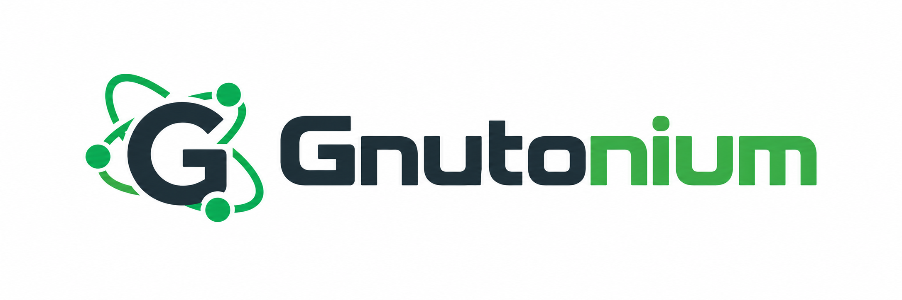
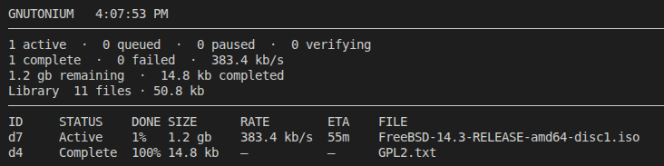

# Gnutonium





(Screenshot: Gnutonium's download monitor. Keep the client running and run
`gnutonium status --config gnutella.json` to view active downloads [docs](CLI.md#status-panel) for more details.)


**Don't know what Gnutella is?:** Read my overly enthusiastic explanation [here](https://rickcarlino.com/notes/p2p/gnutella-explanation.html).

Gnutonium is a single-file, text-based Gnutella client.
You can also use it as an embedded Gnutella engine in your own TypeScript app.

It is compatible with major clients on the Gnutella network in 2026 like GTK-Gnutella, Phex, Shareaza and others.
It is portable, requiring a single executable. We strive to reduce the number of third party dependencies where possible.

## Prebuilt Binaries

- Windows: [64 Bit](https://github.com/gnutonium/Gnutonium/releases/latest/download/gnutonium-windows-x64.exe), [Baseline\*](https://github.com/gnutonium/Gnutonium/releases/latest/download/gnutonium-windows-x64-baseline.exe)
- Mac: [Intel](https://github.com/gnutonium/Gnutonium/releases/latest/download/gnutonium-darwin-x64), [Apple Silicon](https://github.com/gnutonium/Gnutonium/releases/latest/download/gnutonium-darwin-arm64)
- Linux: [64 Bit](https://github.com/gnutonium/Gnutonium/releases/latest/download/gnutonium-linux-x64), [Baseline\*](https://github.com/gnutonium/Gnutonium/releases/latest/download/gnutonium-linux-x64-baseline), [ARM64](https://github.com/gnutonium/Gnutonium/releases/latest/download/gnutonium-linux-arm64)
- Linux (Alpine / musl): [64 Bit](https://github.com/gnutonium/Gnutonium/releases/latest/download/gnutonium-linux-x64-musl), [Baseline\*](https://github.com/gnutonium/Gnutonium/releases/latest/download/gnutonium-linux-x64-musl-baseline), [ARM64](https://github.com/gnutonium/Gnutonium/releases/latest/download/gnutonium-linux-arm64-musl)
- [All releases](https://github.com/gnutonium/Gnutonium/releases)

\* Baseline builds support older x64 CPUs that cannot run the standard build.

After downloading a Gnutonium build, run the executable directly:

```bash
./gnutonium-linux-x64 init --config gnutella.json
./gnutonium-linux-x64 run --config gnutella.json
```

## Install From npm

Gnutonium requires Bun 1.4.4 or newer. **NOTE:** Gnutonium does not work on Node yet - raise an issue if this is a feature you want.

```bash
npm install -g gnutonium
gnutonium init --config gnutella.json
gnutonium run --config gnutella.json
```

## From Source

If you want to run from source:

```bash
bun install
bun run bin/gnutonium.ts init --config gnutella.json
bun run bin/gnutonium.ts run --config gnutella.json
```

## Library Use

Install the library with `npm install gnutonium` and run it with Bun (not Node).

```ts
import { GnutellaServent, loadDoc } from "gnutonium";

const configPath = "./gnutella.json";
const doc = await loadDoc(configPath);
const node = new GnutellaServent(configPath, doc);

await node.start();
node.sendQuery("hello world");
```

Gnutonium identifies itself on the network with vendor code `NIUM`.

## Guides

- [Quickstart](QUICKSTART.md): get the CLI working in a few minutes
- [CLI Guide](CLI.md): full command and config reference
- [Developer Guide](DEVELOPER.md): embed Gnutonium and follow the source reading guide

## License

Gnutonium is released under the GNU General Public License v3.0. See [LICENSE](LICENSE).
